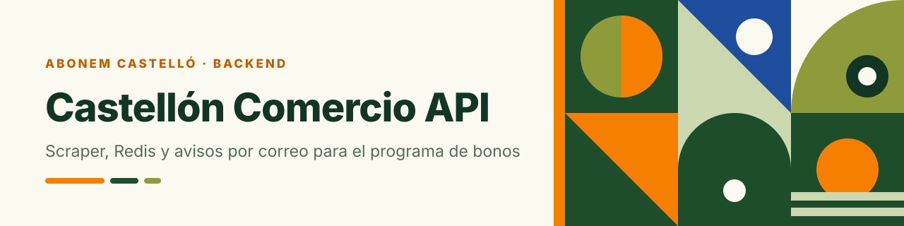
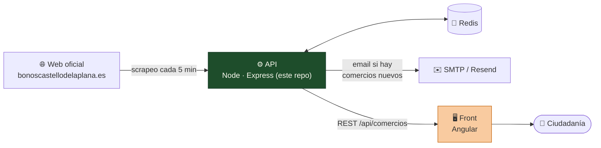
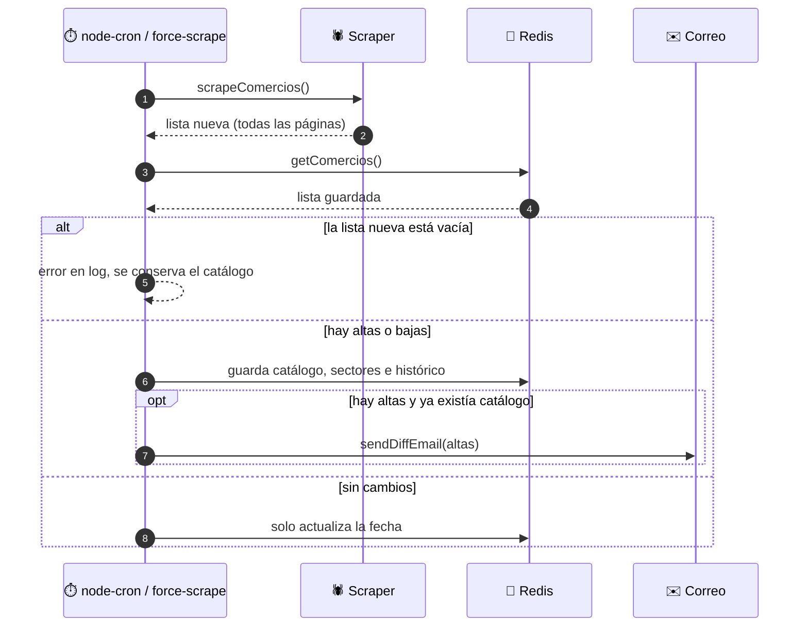
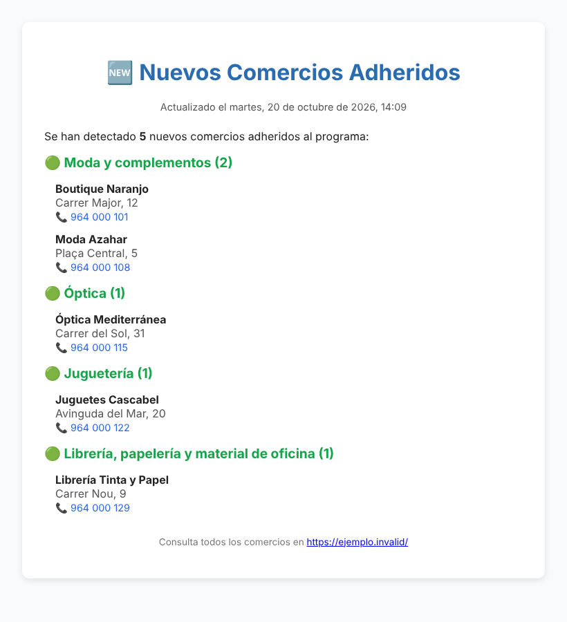

<div align="center">




# Castellón Comercio · API

**Vigila la web oficial del programa de bonos, guarda el histórico y avisa cuando aparecen comercios nuevos.**
<br>Backend de la web [Castellón Comercio](https://bono-castellon.alvaromaxter.es/) · [código del front](https://github.com/ElMaxter99/castellon-comercio-notificator-front).

[](https://bono-castellon.alvaromaxter.es/)

[](CHANGELOG.md)
[](https://nodejs.org)
[](https://expressjs.com)
[](https://redis.io)
[](docker-compose.yml)
[](docs/HOSTING.md)
[](docs/OPERATIONS.md)

[🌐 Web pública](https://bono-castellon.alvaromaxter.es/) · [Ecosistema](#-ecosistema) · [Cómo funciona](#-cómo-funciona) · [Arranque rápido](#-arranque-rápido) · [Endpoints](#-endpoints) · [Documentación](#-documentación) · [🖥️ Front](https://github.com/ElMaxter99/castellon-comercio-notificator-front)

</div>

> [!NOTE]
> **Proyecto independiente y sin ánimo de lucro.** Los datos se obtienen de la web oficial del programa ([bonoscastellodelaplana.es](https://bonoscastellodelaplana.es)) y se ofrecen solo con fines informativos. Sin relación con el Ayuntamiento de Castelló de la Plana ni con CONFECOMERÇ.

---

## 🧭 Ecosistema

Este repositorio es **solo el backend**. La interfaz está en el [**front**](https://github.com/ElMaxter99/castellon-comercio-notificator-front) (Angular), que consume este API.



| Repositorio | Qué hace | Documentación |
|---|---|---|
| ⚙️ **API** (este) | Scraper, Redis, histórico, avisos por correo y REST | [`docs/`](docs) · [`CLAUDE.md`](CLAUDE.md) |
| 🖥️ [**Front**](https://github.com/ElMaxter99/castellon-comercio-notificator-front) | Web con las ediciones 2025 (demo) y 2026 | [`docs/`](https://github.com/ElMaxter99/castellon-comercio-notificator-front/tree/develop/docs) |
| 🌐 **Web pública** | La web en producción que consume este API ([alternativa en Vercel](https://castellon-comercio-notificator-fron.vercel.app/)) | [bono-castellon.alvaromaxter.es](https://bono-castellon.alvaromaxter.es/) |

## ✨ Qué hace

- 🔁 **Scrapea** el listado oficial (axios + cheerio) cada 5 minutos y recorre todas las páginas.
- 💾 **Guarda en Redis** el catálogo, los sectores, la fecha del último scrapeo y el **histórico** de altas y bajas.
- ✉️ **Avisa por correo** cuando aparecen comercios nuevos, con **SMTP tradicional o [Resend](https://resend.com)**.
- 📦 **Expone una API REST** para el front: listado, estado, histórico, sectores y filtro.
- 🛡️ **Robusto**: no vacía el catálogo si la web falla, limpia coordenadas erróneas, limita peticiones por IP, escapa el HTML del correo y reintenta las descargas.
- 🐳 **Despliegue sencillo**: Docker Compose o gratis con Render + Upstash ([guía](docs/HOSTING.md)).

## 🔄 Cómo funciona



El correo que recibes cuando hay comercios nuevos (captura con **datos ficticios**, generada con la plantilla real):

<p align="center"></p>

## 🚀 Arranque rápido

### Con Docker (API + Redis)

```bash
git clone https://github.com/ElMaxter99/castellon-comercio-notificator-api.git
cd castellon-comercio-notificator-api
cp .env.example .env        # rellena Redis y, si quieres, el correo
docker compose up --build   # API en http://localhost:12001
```

### Sin Docker

Necesitas **Node.js ≥ 22** y un Redis accesible (`REDIS_HOST=localhost` en `.env`).

```bash
npm install
npm start
npm test      # tests (runner integrado de Node)
```

Con Redis vacío, el primer arranque hace un **scrapeo inicial** (sin enviar correo). Comprueba que todo va bien:

```bash
curl http://localhost:12001/api/status
curl http://localhost:12001/api/comercios/status
```

### ☁️ Gratis en la nube

`render.yaml` (Blueprint de Render) + Redis en Upstash + un *pinger*: [`docs/HOSTING.md`](docs/HOSTING.md).

## ⚙️ Configuración

Copia [`.env.example`](.env.example). Las variables principales:

| Variable | Uso |
|---|---|
| `NODE_ENV` · `PORT` | Entorno (`prod` → Redis DB 0) y puerto (por defecto 12001) |
| `REDIS_URL` *(o `REDIS_HOST`/`PORT`/`PASSWORD`)* | Conexión a Redis (`rediss://` en servicios con TLS) |
| `REDIS_NAMESPACE` | Prefijo de claves; **cámbialo por edición** (p. ej. `bonos2026`) |
| `MAIL_ENABLED` · `MAIL_TO` | Activar los avisos y destinatario(s), separados por comas |
| `MAIL_PROVIDER` | `smtp` (por defecto) o `resend` (API HTTPS, necesario en hosts que bloquean SMTP) |
| `MAIL_HOST`/`PORT`/`USER`/`PASS` | Solo SMTP (en Gmail, contraseña de aplicación) |
| `RESEND_API_KEY` · `MAIL_FROM` | Solo Resend (el remitente debe ser de un dominio verificado) |
| `FRONTEND_URL` | Enlace que aparece en el correo |
| `FORCE_SCRAPE_TOKEN` | Token de `force-scrape` (sin definir, la ruta está deshabilitada) |
| `HEALTH_MAX_AGE_MINUTES` | Antigüedad máxima de los datos para `/api/health` (15) |
| `TRUST_PROXY` · `RATE_LIMIT_*` | Proxy inverso (Render = 1) y límite de peticiones por IP |

Todas, con su valor por defecto, en [`docs/OPERATIONS.md`](docs/OPERATIONS.md).

## 🌐 Endpoints

Base: `http://localhost:12001`. CORS abierto; límite por defecto de 120 peticiones/min por IP.

| Método | Ruta | Devuelve |
|---|---|---|
| `GET` | `/api/status` | Healthcheck (incluye `PING` a Redis) |
| `GET` | `/api/comercios` | Todos los comercios |
| `GET` | `/api/comercios/status` | Entorno, total y fecha de la última actualización |
| `GET` | `/api/comercios/history` | Histórico de altas y bajas (el más reciente primero) |
| `GET` | `/api/comercios/sectors` | Sectores disponibles |
| `GET` | `/api/comercios/filter?name=&sector=` | Comercios filtrados por nombre o sector |
| `GET` | `/api/health` | Salud para monitores: 503 si Redis falla o los datos llevan >15 min sin actualizarse |
| `POST` | `/api/comercios/force-scrape` 🔒 | Fuerza un scrapeo ahora (requiere `Authorization: Bearer $FORCE_SCRAPE_TOKEN`) |

Ejemplo de comercio (datos ficticios):

```json
{
  "name": "Boutique Naranjo",
  "sector": "Moda y complementos",
  "phone": "964 000 101",
  "address": "Carrer Major, 12",
  "img": "https://ejemplo.invalid/imagenes/boutique-naranjo.jpg",
  "mapsUrl": "https://www.google.com/maps/search/?api=1&query=39.986400,-0.037600"
}
```

> El front pinta el mapa a partir de `query=lat,lng` en `mapsUrl`. Referencia completa con ejemplos: [`docs/API.md`](docs/API.md).

## 🧱 Estructura

```
src/
├── app.js                  Express: CORS, rate limit, logs, rutas y arranque del cron
├── cron.js                 runScrape() + programación (*/5 * * * *)
├── scraper/                descarga y parseo de la web oficial
├── routes/comercios.js     endpoints REST
├── services/               Redis, correo (SMTP / Resend) y plantillas
├── middleware/             rate limiter y logger HTTP
├── utils/                  diff, logger, sanitizado
└── templates/              HTML del correo
scripts/                    operación con Docker y reparación de sectores
docs/                       documentación detallada
```

## 📚 Documentación

| Documento | Contenido |
|---|---|
| [`docs/ARCHITECTURE.md`](docs/ARCHITECTURE.md) | Flujo de datos, Redis, middlewares, correo |
| [`docs/API.md`](docs/API.md) | Todos los endpoints con ejemplos |
| [`docs/SCRAPER.md`](docs/SCRAPER.md) | Cómo scrapea y cómo repararlo si la web cambia |
| [`docs/OPERATIONS.md`](docs/OPERATIONS.md) | Variables de entorno, Docker, logs y mantenimiento |
| [`docs/HOSTING.md`](docs/HOSTING.md) | Hosting gratuito: Render + Upstash + pinger |
| [`docs/REUSE-2026.md`](docs/REUSE-2026.md) | Checklist para reutilizar el proyecto en una nueva edición |
| [`CHANGELOG.md`](CHANGELOG.md) | Historial de versiones |
| [`CLAUDE.md`](CLAUDE.md) | Guía del proyecto para trabajar con Claude Code |

La documentación de la interfaz (ediciones, entornos, diseño) está en el [repositorio del front](https://github.com/ElMaxter99/castellon-comercio-notificator-front#-documentaci%C3%B3n).

## 🛡️ Buenas prácticas

- Mantén el cron en intervalos razonables para no sobrecargar la web origen.
- Define un `FORCE_SCRAPE_TOKEN` largo (`openssl rand -hex 32`) si vas a usar `force-scrape`, y monitoriza `/api/health` con alertas.
- Despliega tras HTTPS y revisa los logs; configura alertas de errores de Redis o de envío.
- Usa un `REDIS_NAMESPACE` distinto en cada edición del programa.

## 🤝 Contribuir

Abre un *issue* o una *pull request* desde una rama de `develop` (gitflow). Si tocas el scraper, pruébalo contra la web real: [`docs/SCRAPER.md`](docs/SCRAPER.md).

## 📝 Licencia

Uso exclusivamente informativo y sin fines comerciales. Respeta siempre las condiciones de uso de los datos oficiales del Ayuntamiento de Castelló de la Plana.

<div align="center"><sub>Hecho con 💚 en Castelló</sub></div>
